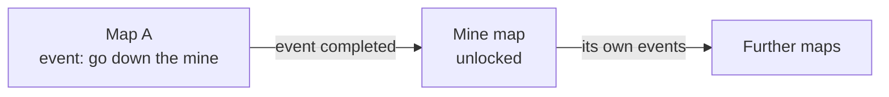

# Maps and Events

Status: v0.1, 2026-11-14. Direction only: the first pillar is decided, the
details are not. A living design document: it records what is decided, marks
proposals, and lists open questions.

## Overview

The game has several maps, and each map has events placed around it. Maps
start locked and are unlocked in different ways. One of those ways is an
event: a map can hold events that unlock other maps. Unlocking maps is one
part of the game's progression.

This doc covers maps, events and how maps are unlocked. What carries over
between runs in general is in [meta-progression.md](meta-progression.md);
how events are shown to the player is in [minimap.md](minimap.md).

## Pillar 1: maps unlocked through events

**Decided:**

- There are **different maps**.
- There are **events around a map**.
- Maps are **unlocked in different ways**; there is more than one way.
- One way is to **find an event in a map and complete it successfully**.
- The unlocks a map offers are **specific to that map**: each map has its
  own set of other maps it can unlock.
- An unlock event **may be hard or impossible without a certain amount of
  progression**. Finding it is not enough.
- Unlocking maps is **one part of progression**, beside the others.

**Example:** a map has a mine. The player goes down the mine and completes
that event, which unlocks the mine map.

**Not decided:** the other ways of unlocking a map, and everything under
Open questions.

## Where the prototype is today

- There is one map and no map selection.
- `WorldMarkers` puts points of interest on the minimap with reveal states,
  using prototype markers (see [systems/minimap.md](../systems/minimap.md)).
  There are no events to complete yet.
- Nothing persists between runs, so an unlock could not be kept yet (see
  [meta-progression.md](meta-progression.md)).

## Open questions

Unlocking:

- [ ] What are the other ways to unlock a map: coins, reaching a level,
      surviving for a time, something else?
- [ ] Is an unlock permanent once earned? (Assumed yes, since it is
      progression, but not stated.)
- [ ] After completing an unlock event, does the player go to the new map
      straight away, or is it only available from the next run?
- [ ] Can one map be unlocked from several maps, or in several ways?
- [ ] Which map is open at the start?

Events:

- [ ] What kinds of event are there besides map unlocks (the minimap doc
      lists shrines, chests, ambushes, bosses)?
- [ ] What does completing an event mean: survive a wave, beat a boss,
      reach a place, hold out for a time?
- [ ] What happens on failure: can the event be retried in the same run?
- [ ] Is an unlock event always in the same place, or placed differently
      each run? Is it always present?
- [ ] Is an unlock event marked differently on the minimap, and is it still
      there once its map is unlocked?

Progression gate:

- [ ] Which progression makes an unlock event possible: in-run levels and
      skills ([weapon-plan.md](weapon-plan.md)), upgrades kept between runs
      ([meta-progression.md](meta-progression.md)), equipment
      ([smithing.md](smithing.md))?
- [ ] Is the gate plain difficulty, or a hard requirement the player is
      told about?

Maps:

- [ ] How do maps differ: enemies, layout, events, rewards, difficulty?
- [ ] Where does the player choose a map: in the base area?

## Changelog

| Date | Version | Change |
| --- | --- | --- |
| 2026-11-14 | v0.1 | First pillar recorded: several maps, events around them, maps unlocked in different ways, one of them completing a map-specific event. |
