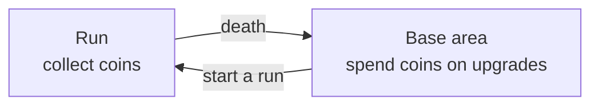

# Meta Progression

Status: v1.3, 2026-11-14. Direction only: the first pillar is decided, the
shape of the system is not. A living design document: it records what is
decided, marks proposals, and lists open questions.

## Overview

Progress carries over between runs. During a run the player collects a
currency; after dying they arrive in a separate base area, where the
currency is spent on upgrades to their character before the next run.

This doc covers what persists between runs and where it is spent. What
happens inside a run (weapons, skills, level-ups) is in
[weapon-plan.md](weapon-plan.md); the run's end as built today is in
[player.md](../systems/player.md), under Death.

## Pillar 1: persistent progression between runs

**Decided:**

- A run is not a clean slate: something the player earns in a run stays
  with them afterwards.
- That something is a **currency collected during runs**: **coins**.
- Coins come in different kinds, and each kind is worth a different amount.
- The currency is spent on **upgrades to the player's character**.
- Spending happens in a **separate area outside the run**, a kind of base,
  where the player can spawn after dying.

**Not decided:** how the meta progression is tied to the base area, and
what shape it takes. Everything under Open questions is still open; nothing
there is ruled in or out yet.

## The loop

Run-only progress (XP, levels, learned skills) resets with each run; the
coins and what they bought do not.

## Where the prototype is today

- Coins exist in five kinds and are collected by touch, but only for the
  run: nothing persists, there is no save data and no base area (see
  [systems/pickups.md](../systems/pickups.md)).
- Death plays the slow death shot and ends on `GameOverScreen`
  (see [player.md](../systems/player.md)). The base area would be where
  that sequence leads.
- XP is run-only.

## Open questions

Coins:

- [x] Which kinds of coin exist, and how much is each worth? Bronze 1,
      silver 5, gold 25, platinum 100, pouch 500.
- [ ] What decides which coin appears: the enemy that dropped it, chance,
      how far into the run the player is?
- [ ] How are coins earned: dropped by enemies, awarded at the end of a
      run, or a mix? (Coins on the ground are picked up by touch, with no
      magnet.)
- [ ] Are all collected coins kept on death, or only a part?
- [ ] Are coins the only persistent currency? Probably not: crafting
      materials are proposed for smithing (see [smithing.md](smithing.md)).

Upgrades:

- [ ] What do upgrades change: plain stats (hearts, speed, damage), which
      skills can be offered, new classes, something else?
- [ ] What shape do they take: a flat list, a tree, things bought from
      characters or buildings in the base?
- [ ] Are upgrades permanent, or can they be refunded and respent?
- [ ] How do they relate to classes and fusions in the weapon plan?

Base area:

- [ ] Is the base a place the player walks around in, or a menu?
- [ ] How is the progression tied to it: is the base only where spending
      happens, or does the base itself grow and change?
- [ ] Does the player always spawn there after dying, or can they restart a
      run directly?
- [ ] Is the base also where the game starts on first launch?

## Changelog

| Date | Version | Change |
| --- | --- | --- |
| 2026-11-14 | v1 | First pillar recorded: currency collected in runs, spent on character upgrades in a base area reached after death. Shape undecided. |
| 2026-11-14 | v1.1 | The currency is coins; different kinds of coin are worth different amounts. |
| 2026-11-14 | v1.2 | Five coin kinds and their values; coins collected by touch. |
| 2026-11-14 | v1.3 | Noted crafting materials (proposed in smithing.md) against the "only currency" question. |
