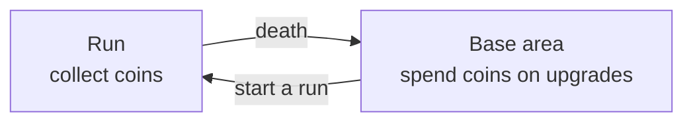

# Meta Progression

Status: v2.1, 2026-11-15. First pass decided and built: coins kept on death,
tiered stat upgrades (one so far) bought in a menu that stands in for the
base area. How it works today: [systems/meta-progression.md](../systems/meta-progression.md).
A living design document: it records what is decided, marks proposals, and
lists open questions.

## Overview

Progress carries over between runs. During a run the player collects a
currency; after dying they arrive in a separate base area, where the
currency is spent on upgrades to their character before the next run.

This doc covers what persists between runs and where it is spent. What
happens inside a run (weapons, skills, level-ups) is in
[weapon-plan.md](weapon-plan.md); the run's end as built today is in
[player.md](../systems/player.md), under Death.

## Pillar 1: persistent progression between runs

**Decided:**

- A run is not a clean slate: something the player earns in a run stays
  with them afterwards.
- That something is a **currency collected during runs**: **coins**.
- Coins come in different kinds, and each kind is worth a different amount.
- The currency is spent on **upgrades to the player's character**.
- Spending happens in a **separate area outside the run**, a kind of base,
  where the player can spawn after dying.

## Decisions (2026-11-15)

- **Menu first, base later.** The base area starts as a menu: a title menu
  (Start, Upgrades) and an upgrade menu. A walkable base may replace it
  once the system is proven; the data and logic behind the menu stay.
- **Upgrades are a tiered stat list.** Each upgrade raises one player stat
  by a fixed bonus per level, and each level costs more. The first and so
  far only one is **magnet radius**. Other systems (smithing, classes) may
  sit beside the list later.
- **All coins are kept on death.** They are banked the moment the player
  dies.
- **Coins come from breakables and events/chests**, not enemies (for
  now). Every source drops through one shared loot mechanism (loot
  tables, see [pickups.md](pickups.md), decision 8), so a new source needs no loot
  code of its own.
- **After death:** the game-over screen offers both a new run straight away
  ("Rise again") and the menu.

### Shape of the system

- **Upgrades are data.** Each upgrade is its own definition (like pickups
  and breakables), so new upgrades of an existing stat need no code, and
  balancing is editing numbers.
- **Upgrades change the base stats once, at the start of a run.** The run's
  systems keep reading the player's stats as before and need not know that
  upgrades exist.
- **Progress is saved after every change** (purchase, banking), not on
  quit, because a phone app can be killed at any moment.

How it is built: [systems/meta-progression.md](../systems/meta-progression.md).

## The loop

Run-only progress (XP, levels, learned skills) resets with each run; the
coins and what they bought do not.

## Where the prototype is today

Built as decided above: see
[systems/meta-progression.md](../systems/meta-progression.md). Coins come
only from barrels so far; there are no chests or events yet. XP is run-only.

## Open questions

Coins:

- [x] Which kinds of coin exist, and how much is each worth? Bronze 1,
      silver 5, gold 25, platinum 100, pouch 500.
- [ ] What decides which coin appears: the enemy that dropped it, chance,
      how far into the run the player is?
- [x] How are coins earned? From breakables and events/chests, through
      loot tables. Not from enemies for now; no end-of-run award.
- [x] Are all collected coins kept on death? Yes, all.
- [ ] Should coins collected be kept when a run is left another way (the
      app closed mid-run)? Today they are only banked on death.
- [ ] Are coins the only persistent currency? Probably not: crafting
      materials are proposed for smithing (see [smithing.md](smithing.md)).

Upgrades:

- [ ] What do upgrades change beyond magnet radius: hearts, speed, damage,
      which skills can be offered, new classes, something else?
- [x] What shape do they take? A tiered stat list to start with.
- [ ] Real costs and bonuses: the magnet's (+0.75 m per level, 10 / 25 /
      50 / 100 / 200 coins) are placeholders for testing.
- [ ] Are upgrades permanent, or can they be refunded and respent?
- [ ] How do they relate to classes and fusions in the weapon plan?

Base area:

- [x] Is the base a place the player walks around in, or a menu? A menu
      first; maybe a walkable base later.
- [ ] How is the progression tied to it: is the base only where spending
      happens, or does the base itself grow and change?
- [x] Does the player always go there after dying? No: both "Rise again"
      and "Menu" are offered.
- [x] Is the base also where the game starts? Yes: the title menu is the
      main scene.

## Changelog

| Date | Version | Change |
| --- | --- | --- |
| 2026-11-14 | v1 | First pillar recorded: currency collected in runs, spent on character upgrades in a base area reached after death. Shape undecided. |
| 2026-11-14 | v1.1 | The currency is coins; different kinds of coin are worth different amounts. |
| 2026-11-14 | v1.2 | Five coin kinds and their values; coins collected by touch. |
| 2026-11-14 | v1.3 | Noted crafting materials (proposed in smithing.md) against the "only currency" question. |
| 2026-11-15 | v2 | First pass decided and built: menu as the base, tiered stat upgrades (magnet radius), all coins kept, coins from breakables/events via loot tables, Profile save. |
| 2026-11-15 | v2.1 | Implementation details moved to systems/meta-progression.md; only the design-level shape stays here. |
