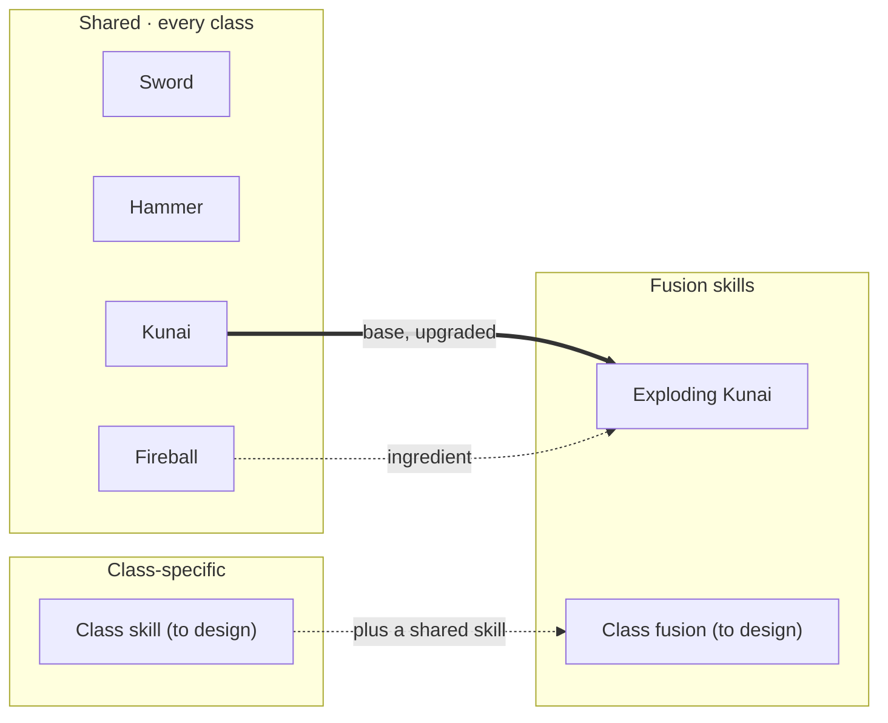

# Weapon Plan — Skills and Fusions

Status: v1, 2026-11-14. A living design document: it records what is decided,
marks proposals, and lists open questions.

## Overview

Players build their power from three kinds of skills: plain weapons every
class can use, class-specific skills, and fusion skills that appear when two
owned skills combine (Kunai + Fireball → Exploding Kunai).

This plan is the first self-contained piece of the game design and covers
weapons and skills only. Other areas (game loops, meta progression, pillars)
get their own plans later. The prototype already has a Sword and a Hammer as
learnable skills and a level-up card choice.

## Skills and weapons

Every skill belongs to one of three kinds; level-ups offer them as random cards.

| Kind | Who can get it | Examples | Notes |
| --- | --- | --- | --- |
| Shared (plain) | Every class | Sword, Hammer, Kunai, Fireball | The common building blocks of every build. Sword and Hammer exist in the prototype. |
| Class-specific | One class only | (to be designed) | Gives each class its own identity and its own fusions. |
| Fusion | Anyone who owns the ingredients | Exploding Kunai | Only offered once its ingredients are learned. See Fusion skills. |

**Levels.** Taking a skill again raises its level, up to its own maximum. In
the prototype every skill has a maximum of 1 so far.

**Level-up offer.** Cards are drawn at random, weighted per skill, from skills
not yet at max level. A skill whose requirements are not met (a fusion, or
another class's skill) is never offered.

## Fusion skills

A fusion skill is an upgrade that only becomes available when the player owns
both of its ingredient skills; the result should read clearly as both parents.

**Rules (proposed defaults, to confirm):**

1. A fusion has exactly two ingredients: shared + shared, or shared +
   class-specific.
2. One ingredient is the **base**. The fusion upgrades the base in place
   (Kunai becomes Exploding Kunai); the other ingredient stays as it is.
3. The fusion card is offered once both ingredients are learned and the base
   is at its max level.
4. A fusion is offered like any other card (weighted random), never forced.
5. One skill can be an ingredient in several fusions, but once its base is
   fused it cannot fuse again.

**Recipes so far:**

| Fusion | Base (upgraded) | Other ingredient | Effect |
| --- | --- | --- | --- |
| Exploding Kunai | Kunai | Fireball | Kunai explode on hit, damaging nearby enemies. |

Solid line: the base skill the fusion replaces. Dashed line: the other
ingredient, which stays. The tree grows to the right as recipes are added;
class skills open fusions that other classes cannot reach.

## Classes

A class decides which class-specific skills a player can be offered, and
through them which fusions they can reach; all classes share the plain weapons.

- Two classes with the same shared weapons can still end up with different
  builds, because their own skills open different fusion branches.
- No classes are designed yet. The first class can simply be "no class":
  shared weapons and fusions only.

## Build steps

Each step is small, self-contained and playable on the phone before the next
one starts.

- [ ] **1. Fusion rules in data.** Skills can name required skills and a skill
      they replace. Prove it with a placeholder fusion of the existing Sword
      and Hammer.
- [ ] **2. Kunai.** A plain thrown weapon, using the existing projectile system.
- [ ] **3. Fireball.** A plain weapon with an area explosion.
- [ ] **4. Exploding Kunai.** The first real fusion; reuses Fireball's
      explosion on Kunai hits.
- [ ] **5. Skill levels.** Skills above max level 1, so "base at max level"
      means something.
- [ ] **6. First class.** One class-specific skill and one fusion that uses it.

## Open questions

- [ ] Does a fusion upgrade the base, consume both ingredients, or add a third
      weapon? (Proposed: upgrade the base.)
- [ ] Must the base be at max level, or is owning both ingredients enough?
- [ ] Are recipes shown to the player (e.g. "combines with Fireball" on a
      card), or found by experimenting?
- [ ] Do fusion skills have their own levels?
- [ ] Is there a cap on how many weapons a player holds at once?
- [ ] Which classes exist, and how many class-specific skills does each get?
- [ ] Can a fusion be an ingredient of another fusion (two tiers deep)?

## Implementation notes

The design fits the existing skill system: fusions and class skills are mostly
new data on `SkillDefinition` plus one filter in `SkillManager.RollChoices`.

| Piece | Today | Change |
| --- | --- | --- |
| `SkillDefinition` (resource, one `.tres` per skill) | Name, description, icon, weapon node, weight, max level | Add `Requires` (skills that must be learned), `Replaces` (the base skill it upgrades), later `Classes` (who may be offered it). |
| `SkillManager.RollChoices` | Offers any skill below max level | Also skip skills whose requirements are not met, or that belong to another class. |
| `SkillManager.Learn` | Switches the skill's weapon node on | For a fusion, also switch the replaced base weapon off. |
| Weapon folders | `weapons/sword/`, `weapons/hammer/`, `weapons/projectiles/` | New `weapons/kunai/`, `weapons/fireball/`, `weapons/exploding_kunai/`, each with its `_skill.tres`. |

Each fusion stays its own weapon node and scene, so Exploding Kunai can reuse
Kunai and Fireball code without either of them knowing about fusions.

## Changelog

| Date | Version | Change |
| --- | --- | --- |
| 2026-11-14 | v1 | First weapon plan: skill kinds, fusion rules, Exploding Kunai, build steps. |
